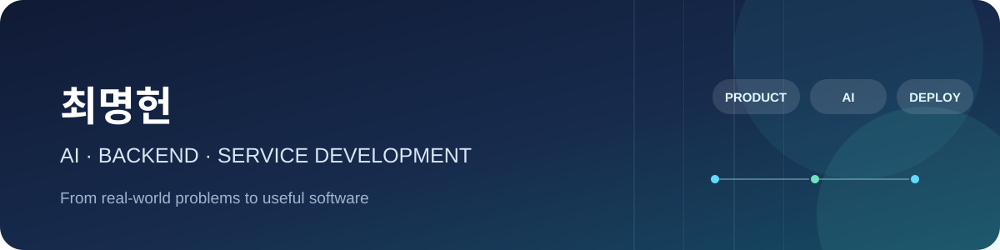

### 프로젝트로 문제를 발견하고, 서비스로 해결합니다

**AI · Backend · Web · Data · Safety · Deployment**

---

## 프로젝트 포트폴리오

현장·가족·조직에서 발견한 문제를 웹 서비스와 운영 가능한 시스템으로 풀어내고 있습니다.  
AI 서비스뿐 아니라 가족 안전, 건설 현장 안전, 시민 서비스, 물류·재고, 동작 분석, 클라우드 배포까지 여러 주제를 다뤘습니다.

| 분야 | 프로젝트 | 만든 것 |
| --- | --- | --- |
| 가족·디지털 안전 | [닿음 (Dahum)](https://github.com/EST-AI-Challengers-31/saver) | 부모님의 스마트폰 위험 정보를 가족이 함께 확인하고 이해하기 쉬운 대응 행동으로 연결하는 모바일 웹 MVP |
| 건설 현장 안전 | [SafeStack Weather Guard](https://github.com/chl4890620123-collab/Star-Developer-2648) | 현장 자재·고정 상태와 풍속 예보를 결합해 강풍에 따른 적재물 위험을 확인하는 시스템 |
| 사내 업무 AI | [Hub](https://github.com/chl4890620123-collab/hub) | 문서·회의 검색을 원문 근거 확인, 담당자 업무, 제출·관리자 승인까지 연결 |
| 이동 현장 지식 | [MOVE AI](https://github.com/HyejiShin-20/MOVEAI) | 기사님의 음성·텍스트 경험을 구조화·검수해 조건에 맞는 현장 지식으로 다시 제공 |
| 태권도 동작 분석 | [AITM](https://github.com/chl4890620123-collab/Aitm) | 영상의 관절 움직임을 측정하고 근거와 함께 점수·코칭을 제공 |
| 물품 생애주기 | [Restok](https://github.com/chl4890620123-collab/Restok-Rangchain) | 물품 등록부터 사용·판매·기부·재활용·폐기까지 이력 관리 |
| 제작·판매 분석 | [Maple Craft Analytics](https://github.com/chl4890620123-collab/maple) | 제작비·수수료·예상 수익과 실제 판매 이력을 계산·분석 |
| 클라우드·DevOps | [한스푼](https://github.com/chl4890620123-collab/hanspoon-frontend) | AWS 인프라, 보안 설정, CI/CD와 헬스체크 기반 배포 흐름 구성 |
| 운영 인프라 | [Server](https://github.com/chl4890620123-collab/Server) | 여러 앱의 Docker 운영 구성과 배포·검증을 관리 |

### 프로젝트 전반에서 다룬 내용

- 문제와 사용자 흐름을 정리하고, 화면에서 다음 행동이 보이도록 설계
- React 화면과 Spring Boot·FastAPI API를 연결하고 데이터 흐름 구성
- 현장·문서·영상 입력을 검색·분석 가능한 데이터로 정리
- AI가 만든 결과를 바로 확정하지 않고 근거와 사람의 검토를 거치도록 설계
- 위험도는 수치 계산과 근거를 함께 보여 주고, 불확실한 상태는 안전하다고 단정하지 않도록 처리
- Docker와 CI/CD로 빌드·검증·배포 흐름 구성

---

## 프로젝트 상세

### 🤝 [닿음 (Dahum) — 가족과 함께 확인하는 스마트폰 안전](https://github.com/EST-AI-Challengers-31/saver)

부모님의 스마트폰에서 발견한 위험 정보를 자녀가 함께 확인하고, 이해하기 쉬운 대응 행동으로 이어 주는 모바일 웹 MVP입니다.

- React 화면, Spring Boot 백엔드, FastAPI AI 서비스, MariaDB를 분리해 구성
- GitHub Actions에서 Docker 이미지를 빌드해 GHCR에 게시하고, 서버는 SHA 태그 이미지를 받아 실행
- Docker Compose와 Caddy를 연결하고, 배포 뒤 시스템 상태와 health check 확인
- 판단 근거가 부족한 정보는 안전하다고 표시하지 않도록 데모 확인 흐름 구성

**기술:** React · Spring Boot · FastAPI · MariaDB · Docker Compose · GitHub Actions · GHCR

### 🌬️ [SafeStack Weather Guard — 건설 현장 풍속 안전](https://github.com/chl4890620123-collab/Star-Developer-2648)

건설 현장의 적재 위치와 자재 정보에 기상 예보를 더해 강풍에 따른 낙하·비산 위험을 확인하는 프로젝트입니다.

- 현장·층·위치, 자재 규격·무게·수량, 고정 상태와 사진을 기준 데이터로 관리
- 현재·예보 풍속 변화를 반영해 위험을 다시 계산하고 민감도와 불확실성 확인
- 위험 위치 수, 원인 자재, 사고 유형, 근거와 권장 조치를 대시보드로 제공
- 풍속만 바뀌는 경우에는 LLM 호출 없이 수치 계산으로 재분석

**기술:** TypeScript · 기상 API · Python 분석 검증

## 경력

### 수호랑캠프 | 교관
**2023.10–2024.03**

### 에스텍시스템 | 보안 사원
**2021.06–2022.12**

### 쿠팡 | 물류센터 업무
**2019.08–2019.11** · IB · OB · ICQA · HUB

### GS25 암사시장점 | 편의점 근무
**2018.01–2018.12**

### GS25 암사점 | 판매원·매니저
**2014.11–2016.03**

---

## 학력 및 교육

- **세한대학교 태권도학과 졸업** · 2010.02–2019.02
- **선사고등학교 문과 졸업**
- **기업연계형 ChatGPT 활용 및 DevOps 개발자 부트캠프** · MBC아카데미 컴퓨터학원 · 2025.10–2026.04  
  Java, Python, SQL, React·Vue.js, Spring Boot, CI/CD, Git
- **ICT 컴퓨터 활용 기술** · 동부교육기술원 · 2024.09–2025.01  
  Linux, vi, VMware 기반 서버 구축, PowerPoint·Excel
- **EST AI 챌린저스 1기** · 이스트소프트 · 2026.07–2026.08  
  Python AI 실무 교육

---

## 자격 및 활동

- 정보기술자격(ITQ) 한글엑셀 A등급 · 2025.01.02 · 한국생산성본부
- 정보기술자격(ITQ) 한글파워포인트 A등급 · 2025.01.02 · 한국생산성본부
- 리눅스마스터 2급 필기 · 2024.11.05
- 이스트소프트 대외 활동 · 2026.08–2026.09
- 태권도 시범단 · 체코 · 2015.02.12–2015.02.22
- 태권도 시범단 · 호주 · 2017.01.21–2017.01.30
- 태권도 시범단 · 미국 · 2019.02.01–2019.02.10
- 육군 병장 만기 전역 · 2019.11–2021.05

---

## 개발자로서의 방향

현장 경험을 바탕으로 반복되는 불편을 찾고, 사용자가 이해하기 쉬운 서비스 흐름으로 바꾸는 데 관심이 있습니다. Restok에서는 물품 관리 경험을 입고·출고, 사용자 지정 URL, 이력 관리와 AI 보조 기능으로 구체화했습니다.

협업에서는 회의 내용을 정리해 공유하고, 주석과 문서로 코드의 의도와 동작을 설명하는 것을 중요하게 생각합니다. AI가 생성한 코드도 그대로 적용하지 않고 로직·중복·보안 설정을 확인하며, 운영 단계에서 관리할 수 있는 구조로 다듬고 있습니다.

---

## 기술 및 역량

- **백엔드:** Java · Spring Boot · JSP · Python · FastAPI
- **프론트엔드:** React · Vue.js · JavaScript · TypeScript · HTML · CSS
- **데이터베이스:** SQL · MariaDB · PostgreSQL · SQLite
- **AI·데이터 처리:** Gemini · LangChain · RAG · MediaPipe · OpenCV · 문서·음성 처리
- **배포·협업:** AWS · Terraform · Docker · Docker Compose · CI/CD · Git · GitHub Actions
- **개발 방식:** 사용자 흐름 설계 · API와 데이터 연동 · 권한·보안 고려 · 테스트와 배포 검증

---

**프로젝트 코드와 상세 내용은 각 저장소에서 확인할 수 있습니다.**

[닿음](https://github.com/EST-AI-Challengers-31/saver) · [SafeStack](https://github.com/chl4890620123-collab/Star-Developer-2648) · [Hub](https://github.com/chl4890620123-collab/hub) · [AITM](https://github.com/chl4890620123-collab/Aitm) · [Restok](https://github.com/chl4890620123-collab/Restok-Rangchain) · [Maple](https://github.com/chl4890620123-collab/maple)

